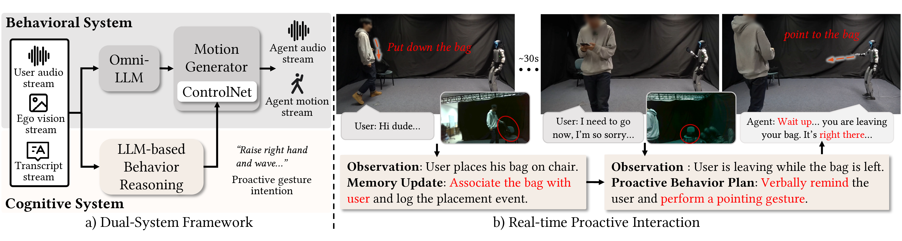
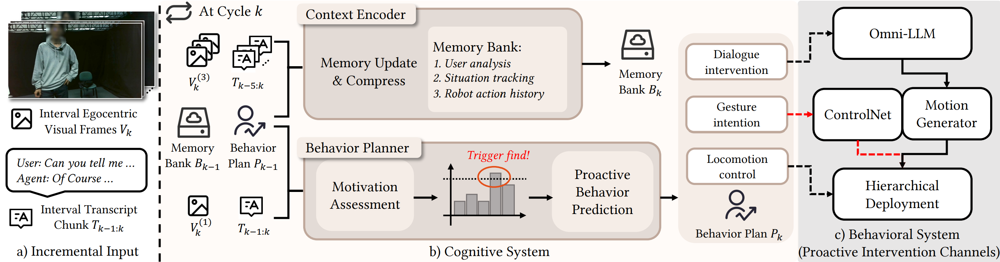

# SIGGRAPH Asia 2026 Journal Track<br>ProAct: Harnessing Streaming Motion Generation and Agentic Reasoning for Real-Time Embodied Social Interaction

[Zeyi Zhang](https://lumen-ze.github.io/)<sup>&#42;</sup>, [Zixi Kang](https://usanococr.github.io/)<sup>&#42;</sup>, Ruijie Zhao<sup>&#42;</sup>, [Yusen Feng](https://wangchek.github.io/), [Biao Jiang](https://biaojiang.tech/), Hanyu Ji, [Libin Liu](https://libliu.info/)<sup>✉</sup>

Peking University, China<br><sup>&#42;</sup> Equal contribution · <sup>✉</sup> Corresponding author

---

<p align="center">
  <a href="https://arxiv.org/pdf/2602.14048v2">
    
  </a>
</p>

<p align="center">
  Video (<a href="https://youtu.be/q4HXfnLmXAE">YouTube</a>) ·
  Paper (<a href="https://arxiv.org/abs/2602.14048">arXiv</a>) ·
  <a href="https://proactrobot.github.io/">Project Page</a> ·
  <a href="https://huggingface.co/UsanoCoCr/ProAct">Models</a> ·
  <a href="https://huggingface.co/datasets/UsanoCoCr/ProAct-Data">Dataset</a>
</p>

This is the official implementation of **ProAct**.
ProAct combines streaming speech and motion generation with a parallel Cognitive
System for memory, social reasoning and proactive behavior.

This codebase provides:

- [x] Real-time interaction and streaming motion inference on G1.
- [x] Pretrained motion models and processed motion datasets.
- [x] Data preparation, training and motion retargeting tools.
- [x] ProActBench sessions and prediction evaluation scripts.

See the [documentation](docs/README.md) for setup and usage, and please cite our
[paper](https://arxiv.org/abs/2602.14048) if you use the code, models or data.

## Quick start

Follow [Setup](docs/guides/setup.md) to install dependencies, download the model
assets and export your `.env` settings. Then run in two terminals:

```bash
# Motion server
CUDA_VISIBLE_DEVICES=0 python proact.py serve --port 32558

# Interaction client, with the same exported environment
python proact.py interact --need_slow_thinking --asr --allow-interrupt --render_target mujoco
```

Use `--render_target none` for interaction without a simulator.
See the [inference guide](docs/guides/inference.md) for deployment and GPU checks.

## Repository

Only four directories at the top level:

```text
ProAct/
├── src/       Runtime, models, prompts and bundled assets
├── configs/   Inference, training and preprocessing settings
├── tools/     Benchmark, retargeting, validation and tests
└── docs/      Usage guides, figures and licenses
```

`proact.py` is the common entry point. Downloaded datasets, checkpoints and
runtime outputs stay outside the tracked source.

## Use ProAct

| Task | Entry point | Guide |
| --- | --- | --- |
| Run the system | `python proact.py serve` / `interact` | [Inference](docs/guides/inference.md) |
| Prepare data and train | `python proact.py prepare seg` / `train backbone` | [Training](docs/guides/training.md) |
| Validate and evaluate predictions | `python proact.py benchmark validate` / `evaluate` | [Evaluation](docs/guides/evaluation.md) |
| Convert BVH to G1 | `python proact.py retarget ...` | [Retargeting](tools/retargeting/README.md) |
| Run offline checks | `python proact.py check` | [Checks and evaluation](docs/guides/evaluation.md) |

The matching audio preprocessing exports are [bundled with the source](src/assets/preprocessing/audio/README.md).
Models and SeG data are provided through the links above.

## System overview

<p align="center">
  
</p>

See the [code map](docs/guides/structure.md) for implementation responsibilities.
The figures are original project assets; [sources and attribution](docs/images/README.md).

## Citation and license

Please cite the [ProAct paper](https://arxiv.org/abs/2602.14048); citation metadata
is in [CITATION.cff](CITATION.cff). Original source code uses the [MIT License](LICENSE).
Models, datasets, figures and third-party components retain their own terms;
see [third-party notices](docs/THIRD_PARTY_NOTICES.md).
