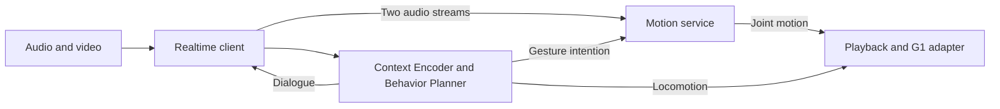

# Code map

`proact.py` routes task commands to the canonical scripts. It uses the active
Python environment, sets the motion module path and runs from the repository
root. Use `--dry-run` before the command to inspect its native invocation.

| Responsibility | Main implementation |
| --- | --- |
| Audio/video capture and Realtime interaction | `src/client/realtime_client.py` |
| Memory, motivation and proactive planning | `src/client/cognition.py` |
| Playback, interruption and device adapters | Other modules in `src/client/` |
| HTTP/WebSocket session and motion orchestration | `src/server/motion_server.py` |
| Training and motion model construction | `src/motion/Gesture_trainer.py`, `src/motion/train.py` |
| Main generator and solver | `src/motion/generate_multimodal_gestures.py`, `src/motion/ddpm/flow_matching_new.py` |
| Features and preprocessing compatibility | `src/motion/data_process/` |
| Runtime/train/preparation settings | `configs/` |
| Scripted cases and prediction scoring | `tools/proactbench/` |
| Offline BVH-to-G1 conversion | `tools/retargeting/` |
| Vendor robot communication | `src/third_party/unitree_sdk2py/` |

The repository exposes four top-level directories: `src/`, `configs/`, `tools/`
and `docs/`. Runtime modules and bundled assets live under `src/`; benchmark,
retargeting and validation utilities live under `tools/`. Historical pickle
module names (`data_process.pymo` and `pymo`) remain supported, and checkpoint
tensor names retain their existing layout.

Raw data, weights, local settings and runtime records are ignored.
Inference configuration snapshots default to `runtime/motion/` or the explicit
`MOTION_OUTPUT_DIR`, keeping generated YAML files out of the source root.
The three small named audio preprocessing exports are deliberately tracked under
`src/assets/preprocessing/audio/`. See [setup](setup.md) for model and dataset
downloads and [the asset manifest](../../src/assets/preprocessing/audio/manifest.json)
for the bundled preprocessing checksums.
